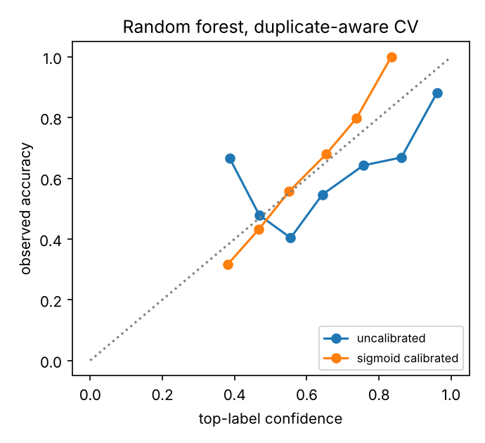

# Maternal health risk in rural Bangladesh: a duplicate-aware reliability audit

[](https://github.com/Shadman19/maternal-risk-reliability-bd/actions/workflows/ci.yml)

This repository re-evaluates standard models on the UCI Maternal Health Risk dataset, which was collected from hospitals, community clinics and maternal health care centers in rural Bangladesh (Ahmed, 2020). It asks three questions:

1. How much of the accuracy that ordinary cross-validation reports survives when identical records cannot sit on both sides of a split?
2. Are the predicted probabilities calibrated, and can they support a screening rule with a fixed sensitivity for high risk?
3. How do conformal prediction sets and recall by age band behave under the same duplicate-aware evaluation?

This is a methods audit of a public research dataset. It is not a clinical tool and should not be used for care decisions.

## Main results

Full run: 10 repeats of 5-fold cross-validation, random forests with 300 trees, 627 seconds on a 2-core CPU. Intervals are the 2.5th to 97.5th percentiles across repeats unless stated otherwise. Every number below is read from `results/results.json`.

**Most rows are repeats.** Of 1,014 rows, 452 are distinct and 562 are exact copies of other rows. 884 rows share their feature vector with at least one other row (largest group: 34 rows), and 35 feature vectors appear with more than one risk label.

**Random splits leak.** Under a random, stratified 80/20 split, 79.4% (74.5 to 84.6) of test rows have an identical feature vector in the training split (50 seeds).

**Accuracy depends on the split.** Accuracy / macro F1:

| Model | Row-level CV | Duplicate-aware CV | Deduplicated, duplicate-aware CV |
|---|---|---|---|
| Logistic regression | 61.8% (61.2 to 62.4) / 60.7% (60.2 to 61.3) | 60.5% (59.9 to 61.5) / 59.4% (58.5 to 60.4) | 66.8% (66.2 to 67.6) / 53.2% (52.4 to 54.2) |
| Random forest | 84.2% (83.2 to 85.1) / 84.6% (83.5 to 85.5) | 66.0% (64.9 to 67.3) / 63.9% (62.6 to 65.6) | 71.3% (70.6 to 72.3) / 63.7% (62.5 to 64.9) |
| Gradient boosting | 84.3% (83.3 to 85.4) / 84.7% (83.7 to 85.7) | 66.1% (64.7 to 69.1) / 64.3% (62.3 to 68.3) | 69.7% (68.6 to 71.2) / 63.4% (61.6 to 65.3) |

Row-level CV is stratified 5-fold on rows. Duplicate-aware CV is stratified group 5-fold with one group per distinct feature vector, so all copies of a record stay in one fold. The deduplicated scheme keeps one copy of each distinct row (features and label) and then applies the duplicate-aware scheme; its class balance differs from the full data (low risk is 51.8% of distinct rows versus 40.0% of all rows), so compare macro F1 rather than accuracy across schemes.

**Calibration.** Top-label expected calibration error (10 equal-width bins) under duplicate-aware CV, before and after sigmoid calibration fit on inner grouped folds of each training fold:

| Model | Uncalibrated | Sigmoid calibrated |
|---|---|---|
| Logistic regression | 0.064 (0.041 to 0.077) | 0.077 (0.062 to 0.100) |
| Random forest | 0.124 (0.104 to 0.140) | 0.051 (0.030 to 0.077) |
| Gradient boosting | 0.247 (0.214 to 0.260) | 0.055 (0.042 to 0.068) |

Brier score and negative log-likelihood are in `results/summary.md`.

**Screening for high risk.** A threshold on the random forest's P(high risk), chosen inside each training fold to reach 90% sensitivity on inner out-of-fold scores and then applied to the held-out fold, gave held-out sensitivity 89.3% (87.4 to 91.2) and specificity 82.3% (81.0 to 83.7), and flagged 36.9% (35.4 to 38.3) of all records.

**Conformal prediction sets.** Split conformal prediction (LAC score) with a 90% coverage target, calibrated on held-out duplicate groups inside each training fold, covered 90.7% (87.3 to 93.7) of records with a mean set size of 1.768 (1.638 to 1.838) labels. Coverage by true class: low risk 97.4% (96.2 to 98.5), mid risk 80.0% (71.8 to 87.2), high risk 93.8% (91.6 to 96.0). The guarantee is marginal, so per-class coverage can fall below the target.

**Recall of high risk by age band (exploratory).** Uncalibrated random forest, duplicate-aware CV, one seed; 95% intervals from a bootstrap over duplicate groups:

| Age band | Rows | High-risk rows | High-risk recall | 95% interval |
|---|---|---|---|---|
| under 20 | 279 | 39 | 61.5% | 39.3% to 81.0% |
| 20 to 34 | 417 | 79 | 82.3% | 67.7% to 93.6% |
| 35 and over | 318 | 154 | 92.2% | 85.4% to 96.9% |



## Reproduce

```
pip install -r requirements.txt
pytest -q
python scripts/run_all.py          # full run
python scripts/run_all.py --quick  # 3 repeats and 100 trees, used in CI
```

Outputs are written to `results/` (`results.json`, `summary.md` and `figures/`).

## Layout

| Path | Contents |
|---|---|
| `src/mhr/data.py` | Loading, checksum, duplicate groups and the data audit |
| `src/mhr/splits.py` | Row-level and duplicate-aware folds, leakage check |
| `src/mhr/metrics.py` | Accuracy, macro F1, top-label ECE, Brier, NLL, sensitivity and specificity, bootstrap intervals |
| `src/mhr/conformal.py` | Split conformal prediction sets (LAC) |
| `scripts/run_all.py` | All experiments |
| `tests/` | Unit tests (pytest), run in CI |

## Limitations

- The data has no patient identifiers. Identical records may be repeat measurements of one woman or different women with identical readings. The duplicate-aware scheme treats each distinct record as one unit, which is the cautious choice when the two cannot be told apart.
- The UCI page describes the target as a predicted pregnancy risk intensity level, so the labels are not observed birth outcomes.
- Some values look implausible, for example 2 rows with a heart rate below 40 bpm and ages from 10 to 70. They are kept as published and counted in the audit.
- The UCI page lists 1,013 instances, while the CSV used here has 1,014 data rows. The file was taken from a public GitHub mirror of the UCI data (Lembani/maternal_health_risk); its SHA256 is recorded in `src/mhr/data.py` and checked by the tests. Compare it with your own UCI download.
- This is one small dataset. The age-band table uses one seed and its intervals are wide.

## Data and citation

Data: Ahmed, M. (2020). Maternal Health Risk [Dataset]. UCI Machine Learning Repository. https://doi.org/10.24432/C5DP5D. License: CC BY 4.0.

Introductory paper: Ahmed, M., Kashem, M. A., Rahman, M., and Khatun, S. (2020). Review and Analysis of Risk Factor of Maternal Health in Remote Area Using the Internet of Things (IoT). Lecture Notes in Electrical Engineering, vol. 632.

Code: MIT License (see `LICENSE`). Author: Shadman Mahmood Khan Pathan.
